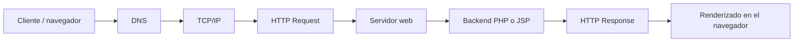

# Laboratorio Grupal Semana 09 - Sistema de Registro de Contactos

Universidad Nacional del Centro del Perú (UNCP) · Facultad de Ingeniería de Sistemas · Curso: Desarrollo de Aplicaciones Web · Unidad II: Desarrollo Web Fullstack.

## Trabajo colaborativo

Este laboratorio fue desarrollado y revisado de manera colaborativa por los integrantes del equipo. La asistencia de Codex se utilizó de forma puntual como apoyo técnico para orientar la estructura del proyecto, revisar controles de validación y realizar comprobaciones locales; las decisiones, comprensión del código y presentación final corresponden al equipo de estudiantes.

## Objetivo

Implementar el mismo sistema de registro de contactos con PHP y con JSP, aplicando arquitectura cliente-servidor, sesiones, validación de datos y seguridad básica de salida.

## Tecnologías

- PHP 8.2 y Apache/XAMPP para `php-app`.
- JSP estándar y Java para `jsp-app`; no se requieren dependencias externas.
- HTML5 y CSS propio adaptable a pantallas pequeñas.

## Estructura

```text
Laboratorio09/
├── php-app/                 # Formulario y procesador PHP
├── jsp-app/                 # Formulario y procesador JSP
│   └── WEB-INF/web.xml
├── evidencias/              # Instrucciones para capturas reales
├── README.md
├── COMPARACION.md
└── .gitignore
```

## Funcionalidades

Ambas implementaciones reciben `nombre` y `correo` por POST, validan campos obligatorios, longitud y correo, eliminan espacios extremos y guardan registros por sesión. Tras un registro válido muestran una tabla numerada. Un dato de nombre se conserva validado, pero solo se convierte a entidades HTML al renderizarlo, por lo que una entrada como `<script>alert('XSS')</script>` se muestra como texto y no se ejecuta.

Los procesadores responden 400 ante datos inválidos y 405 con `Allow: POST` si se accede por GET. Los errores inesperados se registran en el servidor y retornan un mensaje genérico 500.

## Ejecución PHP con XAMPP

1. Inicie Apache desde el panel de XAMPP.
2. Copie `php-app` a `C:\xampp\htdocs\lab09-php` o configure un alias equivalente.
3. Abra `http://localhost/lab09-php/`.
4. El procesador es `http://localhost/lab09-php/registro.php`; una solicitud GET debe devolver 405.

En este entorno se detectó PHP 8.2.12 y XAMPP. La lógica PHP se verificó mediante el servidor de desarrollo local en `http://127.0.0.1:8099/`; Apache/XAMPP no estaba iniciado, por lo que la URL de Apache anterior queda pendiente de comprobación manual.

## Despliegue JSP en Tomcat

1. Detenga Tomcat si está activo y copie `jsp-app` a `C:\xampp\tomcat\webapps\lab09-jsp`.
2. Inicie Tomcat con `C:\xampp\tomcat\catalina_start.bat` o desde el control de XAMPP.
3. Abra `http://localhost:8080/lab09-jsp/`.
4. El procesador es `http://localhost:8080/lab09-jsp/registro.jsp`; por GET debe responder 405.

La JSP usa solamente APIs y sintaxis estándar sin importar paquetes `javax` ni `jakarta`, por lo que es portable entre Tomcat 8.5 detectado y Tomcat 10 para este caso. El Tomcat incluido detectado es 8.5.96. La aplicación se desplegó como `lab09-jsp` y la URL `http://localhost:8080/lab09-jsp/` fue verificada. El lanzador XAMPP no detectó el JDK por el registro de Windows, por lo que Tomcat se inició directamente con el JDK 11 instalado, sin modificar configuración global.

## Ciclo HTTP



En PHP, Apache de XAMPP entrega el recurso y ejecuta PHP; el script valida el POST y escribe/lee la sesión. En JSP, Tomcat recibe la solicitud, traduce/compila la JSP cuando corresponde y ejecuta el código Java que usa la sesión. En `localhost`, la resolución DNS externa puede no ocurrir o resolverse mediante el archivo hosts; los demás pasos lógicos del intercambio HTTP se mantienen.

Consulte la matriz técnica en [COMPARACION.md](COMPARACION.md).

## Pruebas verificadas y pendientes

Se ejecutó `php -l` sin errores. En PHP se verificó mediante HTTP local: POST válido (200), GET al procesador (405 y `Allow: POST`), datos inválidos (400) y salida XSS escapada. En JSP/Tomcat se verificaron esos mismos casos y, adicionalmente, dos POST válidos con la misma cookie para confirmar que la tabla conserva ambos contactos durante la sesión. No se generaron capturas. Quedan pendientes, para ambos entornos, capturas reales, prueba visual de actualización y una ventana privada para comprobar manualmente que una nueva sesión no comparte registros.

## Evidencias

Las rutas y nombres sugeridos para capturas reales se encuentran en [evidencias/README.md](evidencias/README.md). No se han creado evidencias ficticias, logs ni capturas.

## Conclusión

El laboratorio presenta una misma funcionalidad cliente-servidor con PHP y JSP, diferenciando la plataforma de ejecución sin cambiar los controles básicos de validación, sesión y escape de salida. El equipo consolidó y revisó los componentes para su entrega, utilizando apoyo técnico puntual durante el proceso.
